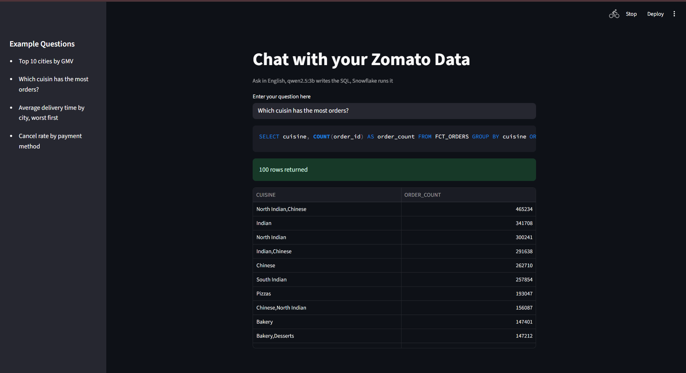
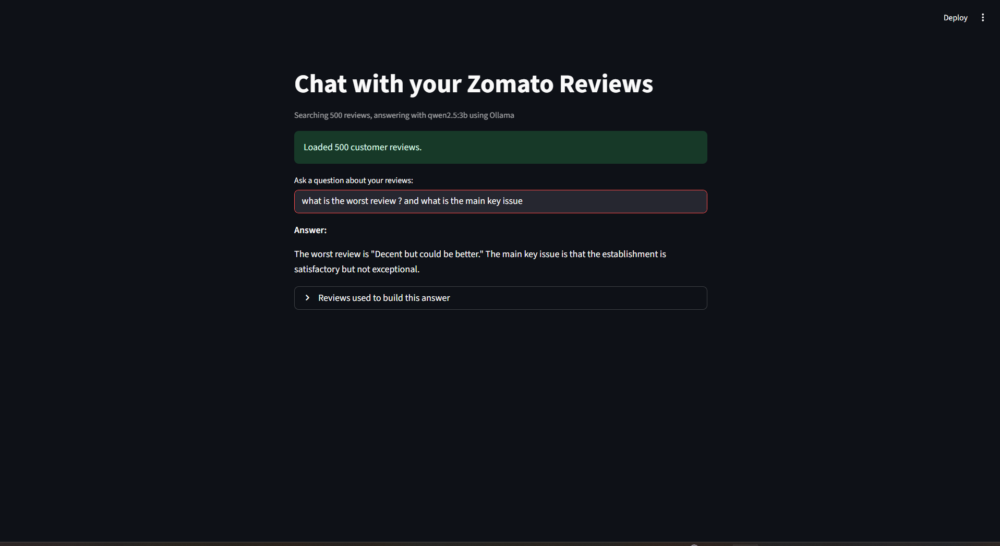

# Zomato End-to-End Data Engineering & AI Project

An end-to-end data engineering and AI project that processes Zomato data
using AWS S3, Snowflake, dbt, and Apache Airflow, then adds AI-powered
review analysis and natural-language interfaces with Ollama and
Streamlit.

**GitHub Repository:**
https://github.com/abhiram0136/zomato-end-to-end-data-engineering-ai

------------------------------------------------------------------------

## Project Overview

This project brings together a cloud-based data pipeline, an analytics
transformation layer, and two AI applications.

-   **Data engineering:** Raw Zomato data is stored in AWS S3 and loaded
    into Snowflake.
-   **Data transformation:** dbt organises and transforms the data into
    staging, dimensional, fact, and mart models.
-   **Workflow orchestration:** Apache Airflow runs the batch workflow
    and coordinates the raw reload, dbt transformations, review
    enrichment, and AI-model build.
-   **AI review enrichment:** Customer reviews are analysed with a local
    Ollama model and stored in Snowflake.
-   **AI applications:** Streamlit applications provide a review-focused
    RAG chatbot and a natural-language-to-SQL interface.

## Architecture

``` text
                    Zomato CSV Data
                           |
                           v
                        AWS S3
                           |
                           v
                       Snowflake
                           |
                           v
                    RAW Schema
                           |
                           v
                 dbt Staging / Core
                 Dimensions and Facts
                           |
                           v
                     Analytics Marts
                           |
             +-------------+-------------+
             |                           |
             v                           v
      Review Enrichment             Business Analytics
       Ollama Model                    in Snowflake
             |
             v
       AI Schema / Enriched Reviews
             |
             v
       dbt AI Review Insights
             |
       +-----+------------------+
       |                        |
       v                        v
  RAG Review Chatbot       Text-to-SQL App
    Streamlit                Streamlit
       |                        |
       +-----------+------------+
                   |
             User Questions

       Apache Airflow orchestrates
       the batch pipeline workflow
```

## Technology Stack

  Area                                   Technologies
  -------------------------------------- ----------------------
  Object storage                         AWS S3
  Data warehouse                         Snowflake
  Data transformation                    dbt
  Workflow orchestration                 Apache Airflow
  Programming                            Python, SQL, Bash
  AI / local LLM                         Ollama, `qwen2.5:3b`
  Embeddings                             `nomic-embed-text`
  Applications                           Streamlit
  Version control                        Git, GitHub
  Infrastructure used for the workflow   Docker

## Pipeline Workflow

The Airflow DAG is named `zomato_batch`. Its successful run is organised
in this order:

``` text
reload_raw
    |
    v
dbt_build_core
    |
    v
enrich_reviews
    |
    v
dbt_build_ai
```

1.  **`reload_raw`** --- reloads raw source data into the Snowflake RAW
    layer.
2.  **`dbt_build_core`** --- builds the core dbt models used for
    analytics.
3.  **`enrich_reviews`** --- analyses customer reviews using the local
    Ollama model and writes the enrichment results to Snowflake.
4.  **`dbt_build_ai`** --- builds the AI/review-insights dbt models
    after enrichment.

The screenshots below show a successful Airflow run in which all four
tasks completed successfully.

## Data Warehouse Layers

The Snowflake database used by the project is `ZOMATO`.

  -----------------------------------------------------------------------
  Schema                              Purpose
  ----------------------------------- -----------------------------------
  `RAW`                               Raw source data loaded into
                                      Snowflake

  `STAGING`                           Staging and transformed analytics
                                      models, including review insight
                                      marts

  `AI`                                AI-enriched review data
  -----------------------------------------------------------------------

Examples of project tables shown in the validation screenshots:

-   `ZOMATO.AI.REVIEW_ENRICHED`
-   `ZOMATO.STAGING.MART_REVIEW_INSIGHTS`

The enriched review output includes fields such as sentiment label,
sentiment score, topic, key issue, model name, and enrichment timestamp.
The review insights mart presents review information grouped into
analytical dimensions such as city, topic, and sentiment.

## AI Features

### 1. Review Enrichment

The review enrichment workflow uses the local Ollama model `qwen2.5:3b`
to analyse customer reviews. The Snowflake enrichment output shown in
the project includes:

-   Sentiment labels such as positive, negative, and neutral
-   Sentiment scores
-   Review topics, such as food quality, packaging, pricing, delivery,
    and service
-   Key issues extracted from reviews
-   Model identifier and enrichment timestamp

### 2. RAG Review Chatbot

The Streamlit review chatbot searches a collection of 500 customer
reviews and uses `qwen2.5:3b` through Ollama to answer questions about
them.

Example question shown:

> What is the worst review, and what is the main key issue?

The application returns an answer and provides an expandable section
showing the reviews used to build that answer.

### 3. Text-to-SQL Application

The Text-to-SQL Streamlit application accepts questions in natural
language. The local model generates SQL, Snowflake executes the query,
and the application displays the returned results.

Example question shown:

> Which cuisine has the most orders?

The application displays the generated SQL and a result table containing
cuisine and order-count columns.

## Screenshots

### 1. Airflow pipeline execution

All four tasks in the `zomato_batch` DAG completed successfully.


### 2. AI-enriched reviews in Snowflake

Sample records from `ZOMATO.AI.REVIEW_ENRICHED`, including sentiment,
score, topic, key issue, and model metadata.


### 3. Review insights mart in Snowflake

Sample records from `ZOMATO.STAGING.MART_REVIEW_INSIGHTS`, showing city,
topic, sentiment, review count, average sentiment score, average star
rating, and flagged issues.


### 4. Text-to-SQL application

A natural-language question is converted into SQL, executed against
Snowflake, and displayed as a result table.



### 5. RAG review chatbot

The chatbot answers a question using the customer-review collection and
shows the reviews used to build its answer.



## Repository Structure

The top-level project layout is:

``` text
ZOMATO END TO END/
|
|-- DATA/
|-- ai/
|   |-- enrich_reviews.py
|   |-- rag_chat.py
|   |-- text_to_sql.py
|
|-- airflow/
|   |-- dags/
|   |   |-- zomato_batch.py
|
|-- zomato/
|   |-- dbt project and model files
|
|-- .gitignore
|-- README.md
```

Large source CSV files, credentials, environment files, local dbt
profiles, generated logs, and build artefacts are excluded from version
control through `.gitignore`. The repository therefore does not contain
the private credentials or the full local data files required to run the
pipeline.

## Prerequisites

Before setting up the project, prepare the following:

-   Python
-   Docker and Docker Compose
-   An AWS account and an S3 bucket containing the source data
-   A Snowflake account with the required database, schemas, warehouse,
    role, and access permissions
-   Ollama with the required models available locally
-   Git

## Configuration

Create your local configuration files and supply your own credentials.
Do not commit secrets to GitHub.

The project uses configuration for the following services:

-   **AWS:** S3 bucket access and permissions.
-   **Snowflake:** account, user/authentication method, role, warehouse,
    database, and schema.
-   **Airflow:** connections and environment configuration required by
    the DAG.
-   **dbt:** a local `profiles.yml` configured for the Snowflake target.
-   **Ollama:** local model availability for `qwen2.5:3b` and
    `nomic-embed-text`.

Use environment variables or local secret/configuration files for
credentials. Keep files such as `.env`, `CREDS.sh`, and `profiles.yml`
out of Git commits.

## Running the Project

The exact commands and configuration values depend on your local AWS,
Snowflake, Docker, and Airflow setup. At a high level:

1.  Clone the repository.
2.  Create and configure the required local environment and secret
    files.
3.  Configure AWS S3 access and Snowflake permissions.
4.  Configure the dbt Snowflake profile.
5.  Start the Airflow services using the project's Docker Compose
    configuration.
6.  Make sure the required Ollama models are installed and the Ollama
    service is available to the AI scripts.
7.  Trigger the `zomato_batch` DAG in Airflow.
8.  Run the Streamlit RAG chatbot and Text-to-SQL applications using the
    corresponding scripts in the `ai/` directory.

Do not copy credentials from screenshots, logs, or another machine. Use
your own service credentials and local configuration.

## Key Learnings

-   Designing an end-to-end batch data pipeline
-   Loading data from object storage into a cloud data warehouse
-   Modelling analytics data with dbt
-   Orchestrating dependent tasks with Apache Airflow
-   Integrating Python, SQL, Snowflake, and local LLMs
-   Enriching unstructured customer reviews with sentiment and topic
    information
-   Building RAG and Text-to-SQL applications with Streamlit

## Future Improvements

-   Add automated data-quality tests and pipeline monitoring.
-   Add incremental processing for larger datasets.
-   Improve review-enrichment evaluation and error handling.
-   Add application-level authentication and deployment configuration.
-   Add CI checks for Python, SQL, and dbt changes.

## Author

**Abhiram**

-   GitHub: [@abhiram0136](https://github.com/abhiram0136)

------------------------------------------------------------------------

If you find this project useful, feel free to explore the repository and
share feedback.
