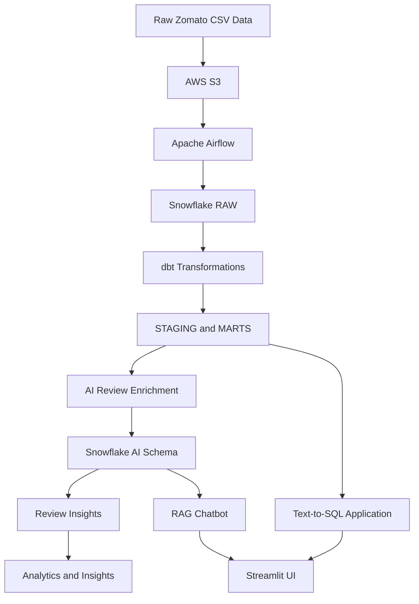

# Zomato End-to-End Data Engineering & AI Project

An end-to-end data engineering and AI project that processes Zomato data using **AWS S3, Apache Airflow, Snowflake, dbt, Python, and Ollama**. The project builds an automated data pipeline and integrates AI-powered applications for restaurant review analysis, Retrieval-Augmented Generation (RAG), and natural-language-to-SQL querying.

---

## Project Overview

This project demonstrates how raw Zomato data can be transformed into structured analytical datasets and enriched with AI.

The pipeline extracts raw datasets, stores them in AWS S3, orchestrates processing through Apache Airflow, transforms data using dbt in Snowflake, and generates AI-powered review insights using locally hosted Large Language Models.

Two Streamlit applications provide interactive access to the processed data:

- **RAG Chatbot:** Answers questions using restaurant review data and semantic search.
- **Text-to-SQL:** Converts natural-language questions into SQL queries and executes them against Snowflake.

## Architecture



## Technology Stack

| Technology | Purpose |
|---|---|
| Python | Data extraction, transformation, and AI integration |
| AWS S3 | Raw data storage |
| Apache Airflow | Workflow orchestration |
| Snowflake | Cloud data warehouse |
| dbt | SQL-based data transformation |
| PostgreSQL | Supporting database integration |
| Ollama | Local LLM execution |
| Qwen 2.5:3B | Review enrichment and natural-language processing |
| nomic-embed-text | Text embeddings |
| Streamlit | Interactive AI applications |
| Docker | Containerization |
| Git & GitHub | Version control |

## Project Structure

```text
ZOMATO-END-TO-END/
|
|-- DATA/
|   |-- mart_review_insights.sql
|
|-- ai/
|   |-- enrich_reviews.py
|   |-- rag_chat.py
|   |-- text_to_sql.py
|
|-- airflow/
|   |-- dags/
|   |   |-- zomato_batch.py
|   |-- Dockerfile
|   |-- docker-compose.yml
|
|-- zomato/
|   |-- models/
|   |   |-- staging/
|   |   |-- marts/
|   |-- macros/
|   |   |-- generate_schema_name.sql
|   |-- analyses/
|   |-- seeds/
|   |-- snapshots/
|   |-- tests/
|   |-- dbt_project.yml
|   |-- README.md
|
|-- .gitignore
|-- README.md
```

## Data Engineering Workflow

### 1. Data Storage - AWS S3

Raw Zomato datasets are stored in Amazon S3.

The datasets include information about:

- Restaurants
- Food items
- Menus
- Orders
- Order items
- Customers
- Reviews

Large source CSV files are intentionally excluded from this GitHub repository. They are maintained separately in AWS S3.

### 2. Workflow Orchestration - Apache Airflow

Apache Airflow orchestrates the complete batch pipeline.

The main DAG is:

`zomato_batch`

The workflow executes the following tasks:

```text
reload_raw
    |
    v
dbt_build_core
    |
    v
enrich_reviews
    |
    v
dbt_build_ai
```

**Task responsibilities:**

- `reload_raw`: Reloads raw source data into Snowflake.
- `dbt_build_core`: Executes core dbt transformations.
- `enrich_reviews`: Performs AI-based review enrichment.
- `dbt_build_ai`: Builds AI-related analytical models.

Docker Compose is used to run the Airflow environment.

### 3. Data Warehouse - Snowflake

Snowflake acts as the central cloud data warehouse.

The project organizes data into multiple layers and schemas, including:

- RAW
- STAGING
- AI

Raw source data is loaded into Snowflake and subsequently transformed into analytical datasets.

### 4. Data Transformation - dbt

dbt is used to transform raw data into structured, reusable analytical models.

**Staging models:**

- `stg_food`
- `stg_order_items`
- `stg_orders`
- `stg_restaurants`
- `stg_review`
- `stg_users`
- `stg_menu`

**Dimension models:**

- `dim_customer`
- `dim_date`
- `dim_food`
- `dim_restaurant`

**Fact models:**

- `fct_orders`
- `fct_order_items`

**Analytical mart models:**

- `mart_dailly_city_revenue`
- `mart_delivery_sla`
- `mart_restaurant_performance`
- `mart_review_insights`

These models provide structured data for downstream analysis and AI applications.

## AI Integration

The project integrates locally hosted LLMs using Ollama.

### 1. AI Review Enrichment

File: `ai/enrich_reviews.py`

Restaurant reviews are processed using an LLM to generate additional information, including sentiment and topic-related insights.

The enriched review data is stored in:

`ZOMATO.AI.REVIEW_ENRICHED`

The AI enrichment workflow is orchestrated through Apache Airflow.

### 2. RAG Chatbot

File: `ai/rag_chat.py`

A Retrieval-Augmented Generation application that allows users to ask questions about restaurant reviews.

**Workflow:**

1. Loads restaurant review data.
2. Generates embeddings using `nomic-embed-text`.
3. Retrieves relevant reviews through semantic similarity.
4. Uses the Qwen 2.5:3B model to generate context-based answers.
5. Displays responses through Streamlit.

The application uses Ollama for local model execution.

### 3. Natural Language to SQL

File: `ai/text_to_sql.py`

This application allows users to interact with Snowflake using natural language.

**Workflow:**

1. User enters a question in natural language.
2. The LLM generates an SQL query.
3. The application executes the query against Snowflake.
4. Query results are displayed through Streamlit.

This makes analytical data more accessible without requiring users to manually write SQL queries.

## Analytical Outputs

The project produces analytical datasets and AI-enriched review insights.

| Model / Table | Purpose |
|---|---|
| `MART_DAILLY_CITY_REVENUE` | City-level revenue analysis |
| `MART_DELIVERY_SLA` | Delivery performance analysis |
| `MART_RESTAURANT_PERFORMANCE` | Restaurant performance analysis |
| `MART_REVIEW_INSIGHTS` | Aggregated restaurant review insights |
| `REVIEW_ENRICHED` | AI-enriched restaurant reviews |

## Running the Project

### Prerequisites

Install or configure the following:

- Python
- Docker Desktop
- Apache Airflow
- AWS account with S3 access
- Snowflake account
- dbt with the Snowflake adapter
- Ollama
- Git

### 1. Clone the Repository

```bash
git clone https://github.com/abhiram0136/zomato-end-to-end-data-engineering-ai.git

cd zomato-end-to-end-data-engineering-ai
```

### 2. Configure AWS and Snowflake

Configure your AWS credentials and Snowflake connection details locally.

Make sure your Snowflake configuration includes the appropriate account, warehouse, database, schema, role, and authentication settings.

Do not upload credentials or local configuration files to GitHub.

### 3. Configure Ollama

Install Ollama and pull the required models:

```bash
ollama pull qwen2.5:3b
ollama pull nomic-embed-text
```

Start the Ollama service before running the AI applications.

### 4. Run the Airflow Pipeline

Navigate to the Airflow directory:

```bash
cd airflow
```

Start the Docker Compose environment:

```bash
docker compose up -d
```

Access the Airflow web interface using the configured webserver address and port.

Enable and trigger the `zomato_batch` DAG.

### 5. Run the RAG Chatbot

From the project root:

```bash
streamlit run ai/rag_chat.py
```

### 6. Run the Text-to-SQL Application

From the project root:

```bash
streamlit run ai/text_to_sql.py
```

**Note:** The applications require their respective local dependencies, environment variables, Snowflake configuration, and Ollama service to be configured. Raw CSV datasets are maintained separately and are not included in this repository.

## Project Validation

The following components were successfully tested during development:

- Apache Airflow batch DAG execution.
- Snowflake data loading and transformations.
- dbt core model execution: 30/30 models passed.
- dbt AI model execution: 1/1 model passed.
- AI review enrichment and Snowflake data storage.
- RAG chatbot retrieval and question answering.
- Natural-language-to-SQL generation and query execution.

## Key Learning Outcomes

Through this project, I gained practical experience with:

- Building end-to-end data engineering pipelines.
- Working with AWS S3 and cloud data storage.
- Orchestrating workflows using Apache Airflow.
- Designing data warehouse transformations using Snowflake and dbt.
- Implementing AI-based text enrichment.
- Working with LLMs and text embeddings using Ollama.
- Building RAG applications.
- Converting natural-language questions into SQL queries.
- Containerizing applications using Docker.
- Integrating data engineering and AI workflows.

## Security and Data Management

Sensitive information and large generated files are intentionally excluded from this repository.

The `.gitignore` file excludes:

- Environment files and credentials.
- Snowflake local configuration files.
- AWS credential files.
- Large source CSV datasets.
- Python virtual environments and cache files.
- dbt generated artifacts.
- Logs and generated embedding files.

Configure credentials locally before running the project.

## Acknowledgement

Project learning and implementation were guided in part by the data engineering tutorials and project concepts shared by **Darshil Parmar**, with additional implementation and AI integration work.

---

## Author

**Abhiram**

GitHub: https://github.com/abhiram0136

Project Repository: https://github.com/abhiram0136/zomato-end-to-end-data-engineering-ai

---

If you found this project interesting, feel free to explore the repository and connect with me!
