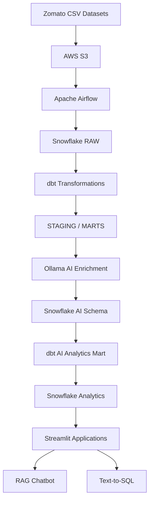

# 🍽️ Zomato End-to-End Data Engineering & AI Project

An end-to-end data engineering project that integrates **AWS S3, Apache Airflow, Snowflake, dbt, Python, and locally hosted LLMs using Ollama** to build an automated data pipeline and AI-powered customer review analytics applications.

The project ingests Zomato datasets, transforms raw data into analytical models, enriches customer reviews using AI, and provides interactive analytics through Retrieval-Augmented Generation (RAG) and Text-to-SQL applications.

## 🚀 Project Overview

This project demonstrates a complete data engineering workflow:

1. Store raw Zomato datasets in AWS S3.
2. Ingest data into Snowflake using Python and Apache Airflow.
3. Transform raw data using dbt.
4. Build fact, dimension, and analytical mart tables.
5. Enrich customer reviews using Ollama and a local LLM.
6. Store AI-generated insights in Snowflake.
7. Build interactive AI applications using Streamlit.

## 🏗️ Architecture



## 🛠️ Technology Stack

| Technology | Purpose |
|---|---|
| Python | Data ingestion, transformation and AI integration |
| AWS S3 | Raw data storage |
| Apache Airflow | Workflow orchestration |
| Snowflake | Cloud data warehouse |
| dbt | Data transformation and testing |
| Docker | Containerization |
| Ollama | Local LLM inference |
| Qwen 2.5 3B | Review classification and text generation |
| Nomic Embed Text | Review embeddings |
| Streamlit | Interactive AI applications |
| SQL | Data querying and analytics |
| Git & GitHub | Version control |

## 📂 Project Structure

```text
ZOMATO-END-TO-END/
│
├── DATA/
│   └── mart_review_insights.sql
│
├── ai/
│   ├── enrich_reviews.py
│   ├── rag_chat.py
│   └── text_to_sql.py
│
├── airflow/
│   ├── dags/
│   │   └── zomato_batch.py
│   ├── Dockerfile
│   └── docker-compose.yml
│
├── zomato/
│   ├── models/
│   │   ├── staging/
│   │   └── marts/
│   ├── macros/
│   ├── analyses/
│   ├── seeds/
│   ├── snapshots/
│   ├── tests/
│   ├── dbt_project.yml
│   └── README.md
│
├── .gitignore
└── README.md
```

Large source CSV files and credentials are intentionally excluded from this repository.

## ⚙️ Data Pipeline Workflow

### 1. Data Ingestion — AWS S3

Raw Zomato datasets are stored in Amazon S3.

The datasets include:

- Restaurants
- Users
- Food
- Menu
- Orders
- Order items
- Reviews

The S3 bucket acts as the raw data source for the pipeline.

### 2. Workflow Orchestration — Apache Airflow

Apache Airflow orchestrates the complete batch pipeline through the `zomato_batch` DAG.

The workflow consists of four tasks:

```text
reload_raw
    |
    v
dbt_build_core
    |
    v
enrich_reviews
    |
    v
dbt_build_ai
```

Each task executes only after its upstream dependency succeeds.

### 3. Data Transformation — dbt

dbt transforms raw data into structured analytical models in Snowflake.

**Staging layer**
- Data cleaning
- Column standardization
- Initial transformations

**Fact and dimension models**
- `FCT_ORDERS`
- `FCT_ORDER_ITEMS`
- `DIM_CUSTOMER`
- `DIM_DATE`
- `DIM_FOOD`
- `DIM_RESTAURANT`

**Analytical marts**
- `MART_DAILLY_CITY_REVENUE`
- `MART_DELIVERY_SLA`
- `MART_RESTAURANT_PERFORMANCE`
- `MART_REVIEW_INSIGHTS`

dbt tests are used to validate data quality and relationships.

### 4. AI-Powered Review Enrichment — Ollama

Customer reviews are processed using a locally hosted LLM.

The enrichment workflow extracts:

- Sentiment label
- Sentiment score
- Review topic
- Key customer issue
- Model information

Models used:

- `qwen2.5:3b` — classification and text generation
- `nomic-embed-text` — text embeddings

The enriched records are stored in:

```text
ZOMATO.AI.REVIEW_ENRICHED
```

This integration uses Ollama locally instead of depending on paid OpenAI API calls.

### 5. AI Analytics Mart

The enriched review data is transformed into an analytical mart:

```text
ZOMATO.STAGING.MART_REVIEW_INSIGHTS
```

This model supports analysis of:

- City-wise customer sentiment
- Review topics
- Average sentiment scores
- Average star ratings
- Flagged customer issues

## 🤖 AI Applications

### 1. RAG-Based Customer Review Chatbot

Application: `ai/rag_chat.py`

The chatbot retrieves relevant customer reviews from Snowflake using vector similarity and uses Ollama to generate contextual responses.

Features:
- Natural-language questions about customer reviews
- Semantic retrieval using embeddings
- Relevant review context
- AI-generated answers
- Retrieved review display

Example questions:

- What are customers saying about food quality?
- What are the most common complaints?
- Summarize negative customer reviews.
- What do customers think about delivery?

### 2. Natural Language to SQL

Application: `ai/text_to_sql.py`

This application converts natural-language business questions into SQL queries using Ollama and executes them against Snowflake.

Features:
- Natural-language SQL generation
- Snowflake query execution
- Tabular result display
- Business analytics without manually writing SQL

Example questions:

- Which cities have the highest GMV?
- Show the top 10 restaurants by performance.
- What is the average delivery time by city?
- Which restaurants have the worst delivery SLA?

## 📊 Final Outputs

The project produces three major outputs:

1. **Snowflake Data Warehouse:** Structured staging, fact, dimension and analytical mart tables.
2. **AI-Enriched Review Dataset:** Customer sentiment, topics and issue classification.
3. **Interactive AI Applications:** RAG chatbot and natural-language-to-SQL analytics.

## 💻 Setup and Execution

### Prerequisites

Install or configure:

- Python
- Docker Desktop
- Apache Airflow
- AWS account and S3 bucket
- Snowflake account
- dbt with Snowflake adapter
- Ollama
- Git

### 1. Clone the repository

```bash
git clone <YOUR_GITHUB_REPOSITORY_URL>
cd ZOMATO-END-TO-END
```

### 2. Configure environment variables

Create the required local `.env` files based on the environment variables referenced by the Python scripts and Docker Compose configuration.

Configure the required credentials for:

- Snowflake
- AWS
- Ollama

Never commit actual credentials.

### 3. Prepare source datasets

Download or retrieve the source CSV datasets from your configured S3 bucket and place them in the expected local data directory if required by your ingestion workflow.

### 4. Start Airflow

```bash
cd airflow
docker compose up -d --build
```

Open the Airflow interface:

```text
http://localhost:8080
```

Trigger the `zomato_batch` DAG.

### 5. Build dbt models

Configure your local dbt profile using your Snowflake credentials.

From the dbt project directory:

```bash
cd ../zomato
dbt debug
dbt build --exclude tag:ai
dbt build --select tag:ai
```

### 6. Start Ollama

Pull the required models:

```bash
ollama pull qwen2.5:3b
ollama pull nomic-embed-text
```

Ensure Ollama is running and accessible to the Python applications and Airflow containers.

### 7. Run the RAG chatbot

From the project root:

```bash
streamlit run ai/rag_chat.py
```

### 8. Run the Text-to-SQL application

Open another terminal:

```bash
streamlit run ai/text_to_sql.py
```

## 🔐 Security and Configuration

The following files and directories are excluded from GitHub:

- `.env` files
- AWS credentials
- Snowflake credentials
- Private dbt profiles
- Generated logs
- Python cache files
- dbt generated artifacts
- Large source datasets

Users must configure their own credentials and environment variables before running the project.

## 📈 Project Validation

The completed implementation was tested with:

- Successful Airflow DAG execution across all four tasks.
- Successful core dbt build: 30 of 30 resources passed.
- Successful AI mart build.
- Successful Ollama review enrichment.
- Verified enriched records in Snowflake.
- Verified AI analytics mart records.
- Successful RAG chatbot demonstration.
- Successful Text-to-SQL query execution.

## 🎯 Key Learning Outcomes

Through this project, I gained practical experience with:

- Building end-to-end batch data pipelines.
- AWS S3 data storage and ingestion.
- Apache Airflow DAG development and orchestration.
- Snowflake data warehousing.
- dbt transformations and data testing.
- Docker-based development environments.
- Local LLM integration using Ollama.
- Embeddings and Retrieval-Augmented Generation.
- AI-powered natural-language-to-SQL systems.
- Building interactive applications with Streamlit.

## 🙏 Acknowledgement

This project was developed following the learning concepts and project guidance from **Darshil Parmar**, with additional implementation work integrating Ollama-based AI applications.

---

**Developed as an end-to-end Data Engineering and AI project.**
